<!-- nav:topo -->
<p align="center">
  
  <a href="docs/API.md"></a>
  <a href="web/README.md"></a>
  <a href="diario-de-bordo/README.md"></a>
  <a href="docs/GUIA_DE_ESTUDOS.md"></a>
  <a href="extras/README.md"></a>
</p>
<!-- /nav:topo -->

<p align="center">
  
</p>

# DSW: Gerenciador de Tarefas

<p>
  <a href="https://gerenciador-de-tarefas.onrender.com"></a>
  
  
  
  
</p>

**Estudante:** Otávio Fertig<br>
**Disciplina:** DSW — Desenvolvimento de Sistemas Web (turma ADS-2025)

Um **gerenciador de tarefas multiusuário**: cada pessoa cria a sua conta, entra com e-mail e senha e organiza as próprias tarefas, com prioridade, busca e filtro. O projeto tem duas partes que funcionam juntas:

- **API** em Node.js + Express + TypeScript ([`server.ts`](server.ts)), com login por JWT e banco de dados **Turso** (SQLite na nuvem);
- **tela** em React + TypeScript + Tailwind CSS ([`web/`](web/)), que a própria API entrega.

O sistema está publicado no **Render**:

[](https://gerenciador-de-tarefas.onrender.com) [](#deploy-no-render)

**Nesta página:** [Funcionalidades](#o-que-o-sistema-faz) · [Comece por aqui](#comece-por-aqui) · [Estrutura](#estrutura-do-projeto) · [Como rodar](#como-rodar) · [Deploy](#deploy-no-render) · [Tecnologias](#tecnologias) · [Andamento](#andamento-por-aula)

## O que o sistema faz

- [x] Criar conta e entrar com e-mail e senha (senha guardada com **bcrypt**, login com **JWT**)
- [x] Cada pessoa vê só as próprias tarefas
- [x] Criar, concluir e excluir tarefas, com prioridade baixa, média ou alta
- [x] Buscar por título, com **debounce** para não chamar a API a cada letra
- [x] Filtrar por prioridade na própria tela
- [x] Dados guardados na nuvem (**Turso**), que não somem quando o servidor reinicia
- [x] Publicado na internet (**Render**), com deploy automático a cada push na `main`
- [ ] Testes automatizados (próximo passo, veja o [roadmap](docs/API.md#roadmap))

## Comece por aqui

| Eu quero... | Vá para |
| --- | --- |
| Abrir o sistema publicado na internet | [](https://gerenciador-de-tarefas.onrender.com) |
| Rodar o projeto na minha máquina | [](#como-rodar) |
| Entender como o sistema foi publicado (deploy) | [](#deploy-no-render) |
| Entender a API: rotas, banco e segurança | [](docs/API.md) |
| Ver a lista de rotas e o que cada uma responde | [](docs/API.md#endpoints) |
| Testar as rotas no VS Code | [](requests.http) |
| Ver como a tela foi feita | [](web/README.md) |
| Revisar o que aprendi em cada aula | [](diario-de-bordo/README.md) |
| Ler a aula mais recente | [](diario-de-bordo/2026-11-18.md) |
| Estudar os conceitos com calma, com glossário | [](docs/GUIA_DE_ESTUDOS.md) |
| Ver os trabalhos de outras aulas (Tailwind, primeiro app React) | [](extras/README.md) |

## Estrutura do projeto

O projeto inteiro fica na raiz do repositório, no mesmo formato do material da disciplina: a API na raiz e a tela na pasta `web/`.

```
dsw-gerenciador-tarefas/
├── server.ts            # a API: rotas, banco, login e entrega da tela
├── package.json         # scripts da API (dev, start, build) e dependências
├── tsconfig.json
├── render.yaml          # receita do deploy no Render
├── .env.example         # modelo do .env com TURSO_URL e TURSO_TOKEN
├── requests.http        # testes das rotas (REST Client do VS Code)
├── web/                 # a tela em React (Vite + TypeScript + Tailwind)
│   └── src/             #   App, Login, Tarefas e api.ts
├── diario-de-bordo/     # o que aprendi em cada aula
├── docs/
│   ├── API.md           # documentação completa da API
│   └── GUIA_DE_ESTUDOS.md
└── extras/              # trabalhos de outras aulas
```

## Como rodar

Precisa do **Node.js 24** e do **npm**.

### 1. Primeira vez

```bash
npm install            # dependências da API
npm --prefix web install   # dependências da tela
```

**Banco de dados:** sem configurar nada, a API grava num arquivo local (`tarefas.db`), o que já basta para testar. Para usar o Turso, copie o `.env.example` para `.env` e preencha os dois valores:

```env
TURSO_URL=libsql://seu-banco.turso.io
TURSO_TOKEN=seu-token
```

O `.env` nunca vai para o GitHub (está no `.gitignore`). Ao ligar, o terminal mostra para onde os dados estão indo:

```
  Modo  : Turso / libSQL (nuvem)
  Onde  : libsql://seu-banco.turso.io
  Token : presente (nunca será mostrado)
```

### 2. Dia a dia: tela e API juntas

Sobe a API e o Vite num terminal só. A tela atualiza sozinha quando você salva um arquivo.

```bash
npm run dev:all
```

[](http://localhost:5173) [](http://localhost:3000/api/health)

### 3. Igual ao Render (a API entrega a tela)

Um servidor só, na porta 3000, do mesmo jeito que roda na nuvem. É o teste a fazer antes de cada `git push`: se o build quebrar aqui, também quebraria no Render.

```bash
npm run build      # instala a tela, gera web/dist e confere os tipos
npm start
```

[](http://localhost:3000)

### 4. Só a API

Para testar as rotas pelo [`requests.http`](requests.http) no VS Code.

```bash
npm run dev
```

**Usuário de teste:** o servidor cria sozinho o `admin@senai.com` com a senha `123456`.

> [!WARNING]
> **"Porta 3000 já está em uso":** já existe outro servidor rodando, provavelmente esquecido em outro terminal. Feche-o com `Ctrl+C` antes de subir de novo.

## Deploy no Render

**Deploy** é colocar o sistema na internet, num endereço que qualquer pessoa consegue abrir. O **Render** pega o código do GitHub, prepara tudo numa máquina dele e deixa o site no ar. Os dados continuam no **Turso**, então nada se perde quando o Render reinicia ou atualiza o servidor.

[](https://gerenciador-de-tarefas.onrender.com) [](https://gerenciador-de-tarefas.onrender.com/api/health) [](https://gerenciador-de-tarefas.onrender.com/api/db-check)

> [!NOTE]
> O plano gratuito do Render "dorme" depois de 15 minutos sem visitas. O primeiro acesso depois disso pode demorar perto de 1 minuto: é o servidor acordando, não um erro.

### Como funciona

Toda vez que um commit chega na `main` do GitHub, o Render refaz o deploy sozinho. Depois, cada pedido da tela passa pela API e chega ao banco:

<p align="center">
  
</p>

<details>
<summary>Ver o mesmo fluxo em texto</summary>

```
 GitHub (main) ──push──▶ Render
                           1. npm install        → dependências da API
                           2. npm run build      → instala a tela, gera web/dist e confere os tipos
                           3. npm start          → liga o servidor
                                      │
                 https://gerenciador-de-tarefas.onrender.com
                   ├── /         → a tela do React
                   ├── /api/...  → a API
                   └── dados ───▶ Turso (banco na nuvem)
```

</details>

Um endereço só entrega a tela e a API. Por isso, em produção, a tela não precisa de CORS: tudo vem do mesmo lugar.

### O que foi preparado no código

| Arquivo | O que mudou | Por quê |
| --- | --- | --- |
| [`package.json`](package.json) | o `build` virou `npm --prefix web install && npm run build:web && tsc` | a máquina do Render começa vazia. Sem instalar a tela antes, o Vite não existe lá e o build quebra |
| [`server.ts`](server.ts) | rota nova `GET /api/db-check` | mostra as tabelas do banco e quantas linhas cada uma tem: confirma que o Render está ligado ao Turso |
| [`render.yaml`](render.yaml) | arquivo novo na raiz | é a "receita" do deploy: nome, plano grátis, comandos, variáveis e health check |

<details>
<summary><b>Passo a passo no painel do Render</b></summary>

1. Entre em [render.com](https://render.com) com a conta do GitHub.
2. Clique em **New + → Web Service** e conecte este repositório.
3. Preencha:

   | Campo | Valor |
   | --- | --- |
   | Name | `gerenciador-de-tarefas` |
   | Runtime | Node |
   | Plan | Free |
   | Build Command | `npm install && npm run build` (o padrão do Render é só `npm install`: não esqueça o `&& npm run build`) |
   | Start Command | `npm start` |

4. Em **Environment Variables**, cadastre as três variáveis:

   | Variável | O que colocar | Cuidado |
   | --- | --- | --- |
   | `JWT_SECRET` | clique em **Generate** | é a chave que assina os logins; o Render cria uma difícil de adivinhar |
   | `TURSO_URL` | `libsql://seu-banco.turso.io` (o mesmo do seu `.env`) | sem `/` no final |
   | `TURSO_TOKEN` | o token inteiro (começa com `eyJ`) | copiar até o fim |

5. Clique em **Create Web Service** e acompanhe os **Logs**. O primeiro deploy leva de 3 a 5 minutos.

> [!TIP]
> Outro caminho: **New + → Blueprint**. O Render lê o `render.yaml` sozinho e só pergunta o `TURSO_URL` e o `TURSO_TOKEN`.

</details>

### Como testar depois do deploy

1. Abra `/api/health`. Deve responder `200` com `"banco": "Turso / libSQL (nuvem)"`. Se aparecer `arquivo local (SQLite)`, as variáveis do Turso não chegaram.
2. Abra `/api/db-check`. Deve responder `ok: true`, com as tabelas `usuarios` e `tarefas` e quantas linhas cada uma tem.
3. Abra o endereço principal, entre com `admin@senai.com` / `123456` e crie uma tarefa.
4. Aperte **F5**. A página deve continuar abrindo, sem erro 404: o servidor devolve a tela do React para qualquer caminho que não seja da API.

<details>
<summary><b>Se algo der errado</b></summary>

| O que aparece | Por que acontece | Como resolver |
| --- | --- | --- |
| A página mostra "Ainda não existe o build do front-end" | o build não gerou a tela | conferir se o Build Command tem o `&& npm run build` |
| `/api/health` responde `503` ou o log mostra erro de banco | `TURSO_URL` ou `TURSO_TOKEN` errados | copiar de novo, sem `/` no final da URL e com o token inteiro |
| `/api/health` diz `arquivo local (SQLite)` | as variáveis do Turso não foram cadastradas | cadastrar as duas em **Environment** e fazer um novo deploy |
| A primeira visita demora quase 1 minuto | o plano gratuito dorme sem uso | é normal: depois de acordar, fica rápido |

</details>

## Tecnologias

| Área | Tecnologias |
| --- | --- |
| Back-end |        |
| Front-end |     |
| Deploy |    |
| Ferramentas |     |

## Andamento por aula

As aulas de setembro em diante seguem a numeração do material do professor (Aula 00 = 02/09). Clique na data para abrir o diário. Verde = back-end, azul = front-end.

<details>
<summary><b>Antes do diário: agosto</b> (Tailwind, primeira API e banco SQLite)</summary>

| Aulas | Tema |
| --- | --- |
| 3 e 4 | Layout com Tailwind CSS (desafio do card responsivo, hoje em [`extras/`](extras/README.md)) |
| 5 · 14/08 | Configuração inicial do back-end: Express + TypeScript, rotas de diagnóstico e CRUD em memória |
| 6 a 10 | Banco SQLite, validação profunda e escrita segura (POST, PUT, PATCH, DELETE) |

</details>

| Aula | Tema | Diário |
| :---: | --- | :---: |
| 00 | Tratamento de erros e testes de ataque | [](diario-de-bordo/2026-09-02.md) |
| 01 | Sanitização da busca e prepared statements | [](diario-de-bordo/2026-09-09.md) |
| 02 | Type guards, allowlists e transações nas rotas de escrita | [](diario-de-bordo/2026-09-16.md) |
| 03 | Autenticação: registro, login, bcrypt e JWT | [](diario-de-bordo/2026-09-23.md) |
| 04 | Protegendo rotas: middleware `authenticate` e tarefas por usuário | [](docs/API.md#fluxo-de-autenticação) |
| 05 | Introdução ao React: componentes, `useState`, `useEffect`, `fetch` e CORS | [](diario-de-bordo/2026-10-07.md) |
| 06 | Lista de tarefas com estado, formulário controlado e componente `Tarefa` | [](diario-de-bordo/2026-10-14.md) |
| 07 | Lista de tarefas ligada à API: debounce na busca, `useRef` e modal acessível | [](web/README.md#como-funciona) |
| 08 | Laboratório: Tailwind, lacunas de lógica e o back servindo o front (`express.static` e SPA fallback) | [](diario-de-bordo/2026-10-28.md) |
| 09 | Banco em nuvem: `@libsql/client` (Turso), `.env` com detecção de BOM, `db.batch()` e rotas assíncronas | [](diario-de-bordo/2026-11-04.md) |
| 10 | Deploy no Render: `render.yaml`, build que instala a tela, `/api/db-check` e variáveis de ambiente | [](diario-de-bordo/2026-11-11.md) |
| 11 | Leitura e análise do front (questionário ENADE), caça ao bug e filtro por prioridade com `useMemo` | [](diario-de-bordo/2026-11-18.md) |

Os pontos em aberto e os próximos passos estão na [documentação da API](docs/API.md#limitações-atuais).

## Observações do Professor

Espaço reservado para as observações e os ajustes solicitados pelo professor ao longo da disciplina. Nenhuma observação registrada até o momento.

<!-- nav:rodape -->
---

<p align="center">
  <a href="#top"></a>
  <a href="docs/API.md"></a>
</p>
<!-- /nav:rodape -->
