<!-- nav:topo -->

  
  
  

<!-- /nav:topo -->

# Aula 05 — Introdução ao React: componentes, useState, useEffect e CORS (07/10/2026)

## ✅ O que eu aprendi

- Componente em React é só uma função que devolve JSX. Dá para dividir a tela em pedaços pequenos, como o Saudacao, e juntar tudo dentro do App.
- O useState guarda um valor que a tela "lembra" entre renderizações. Quando o setter é chamado, o React redesenha o componente com o valor novo, e o número dentro do useState(0) é só o valor inicial.
- O ESLint é um revisor que lê o código e acusa problemas antes de rodar, como variável criada e nunca usada. No template do Vite ele já vem configurado e roda com npm run lint.
- O useEffect com a lista de dependências vazia roda uma vez, quando o componente aparece na tela. É o lugar certo para fazer o fetch inicial ao back-end.
- O erro de CORS não é falha do front: o navegador bloqueia a resposta porque a origem é diferente (localhost:5173 para localhost:3000). Quem libera é o servidor, com app.use(cors()) mandando o cabeçalho Access-Control-Allow-Origin.
- O .map() transforma cada item de um array em um elemento da tela, e a prop key precisa ser única para o React saber qual item é qual quando a lista muda.

## 🧩 Principal dificuldade

A tela do React não mostrava as tarefas da API, e o console do navegador (F12) mostrava um erro de CORS.

## 🔧 Como eu resolvi

O problema não era no front: a API precisava liberar a tela, que está em outro endereço. Instalei o `cors` na API e coloquei `app.use(cors())`, e a lista apareceu.

<!-- nav:rodape -->
---

  
  
  

<!-- /nav:rodape -->
