<!--
  COMO USAR ESTE MODELO
  1. Copie para AAAA-MM-DD.md e troque tudo que está em MAIÚSCULAS.
  2. Botão "ver no projeto": aponte para a seção do README que a aula construiu.
     Back-end:  ../docs/API.md#ANCORA      (botão verde, logo nodedotjs)
     Front-end: ../web/README.md#ANCORA    (botão azul 087ea4, logo react)
  3. Rodapé: o botão "←" aponta para a aula anterior. Depois, abra a aula
     anterior e acrescente no rodapé dela o botão "→" apontando para esta.
  4. Nos badges, espaço vira "_" e acentos ficam codificados (é = %C3%A9,
     ç = %C3%A7, ã = %C3%A3, ó = %C3%B3). Apague este comentário ao terminar.
-->
<!-- nav:topo -->

  
  
  

<!-- /nav:topo -->

# Aula NN — TEMA DA AULA (DD/MM/AAAA)

## ✅ O que eu aprendi

- Um aprendizado por item, com as suas palavras.

## 🧩 Principal dificuldade

O que mais travou nesta aula.

## 🔧 Como eu resolvi

O que fiz para resolver e por que funcionou.

## 💡 Observações

Opcional: outros problemas ou dúvidas que ficaram para a próxima aula.

<!-- nav:rodape -->
---

  
  

<!-- /nav:rodape -->
