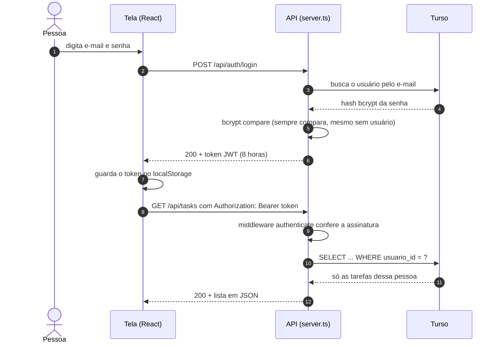

<!-- nav:topo -->
<p align="center">
  <a href="../README.md"></a>
  
  <a href="../web/README.md"></a>
  <a href="../diario-de-bordo/README.md"></a>
  <a href="GUIA_DE_ESTUDOS.md"></a>
  <a href="../extras/README.md"></a>
</p>
<!-- /nav:topo -->

<p align="center">
  
</p>

# API do Gerenciador de Tarefas

Gerenciador de tarefas multiusuário: back-end em **Node.js + Express + TypeScript** com persistência em **SQLite na nuvem** (Turso, via `@libsql/client`). A mesma API entrega a tela em React da pasta [`web/`](../web/README.md). O projeto evolui a cada aula: primeiro as rotas básicas, depois o CRUD, a blindagem contra entradas maliciosas, a autenticação com senha criptografada e JWT e, na Aula 09, a migração do arquivo local para o banco em nuvem. Na Aula 10, o sistema foi publicado no **Render**: [abrir o sistema](https://gerenciador-de-tarefas.onrender.com).

Os arquivos da API ficam na raiz do repositório:

```
dsw-gerenciador-tarefas/
├── server.ts          # API completa (rotas, banco, autenticação, entrega da tela)
├── package.json       # scripts dev, start, build e dev:all
├── tsconfig.json
├── render.yaml        # receita do deploy no Render
├── .env.example       # modelo do .env com TURSO_URL e TURSO_TOKEN
├── requests.http      # cenários de teste por aula (REST Client)
└── web/               # a tela em React, entregue pela API depois do build
```

**Nesta página:** [Como rodar](#como-rodar-a-api) · [Banco em nuvem](#banco-em-nuvem-turso) · [Front pela API](#servindo-o-front-end-pela-api) · [Variáveis](#variáveis-de-ambiente) · [Deploy](#deploy-no-render) · [Tecnologias](#tecnologias) · [Endpoints](#endpoints) · [Modelo de dados](#modelo-de-dados) · [Respostas](#exemplos-de-resposta) · [Autenticação](#fluxo-de-autenticação) · [Segurança](#segurança-aplicada) · [Testes](#testes-com-rest-client) · [Limitações](#limitações-atuais) · [Roadmap](#roadmap)

**Aulas que construíram esta API** (clique para abrir o diário):

<p>
  <a href="../diario-de-bordo/2026-09-02.md"></a>
  <a href="../diario-de-bordo/2026-09-09.md"></a>
  <a href="../diario-de-bordo/2026-09-16.md"></a>
  <a href="../diario-de-bordo/2026-09-23.md"></a>
  <a href="../diario-de-bordo/2026-10-28.md"></a>
  <a href="../diario-de-bordo/2026-11-04.md"></a>
  <a href="../diario-de-bordo/2026-11-11.md"></a>
</p>

## Como rodar a API

Na raiz do repositório:

```bash
npm install
npm run dev     # desenvolvimento, reinicia ao salvar (tsx watch)
npm start       # execução simples
```

O servidor sobe em `http://localhost:3000`. Antes de abrir a porta, ele cria as tabelas (se ainda não existirem) e o usuário semente `admin@senai.com` / `123456`. O banner no terminal diz para onde os dados estão indo:

```
============================================================
  Banco de dados
------------------------------------------------------------
  Modo  : Turso / libSQL (nuvem)
  Onde  : libsql://seu-banco.turso.io
  Token : presente (nunca será mostrado)
============================================================
```

Sem `.env`, o modo é `arquivo local (SQLite)` e os dados ficam em `tarefas.db`, na raiz.

### Banco em nuvem (Turso)

1. Crie a conta e o banco em [turso.tech](https://turso.tech) e copie a URL (`libsql://...`) e um token.
2. Copie `.env.example` para `.env` (na raiz) e preencha os dois valores. Salve em **UTF-8 sem BOM** e confira se a URL não termina com `/`.
3. Rode `npm run dev` e confira o banner, ou chame `GET /api/health`, que responde `"banco": "Turso / libSQL (nuvem)"`.

O `.env` e o `tarefas.db` estão no `.gitignore` e nunca devem ir para o repositório.

### Servindo o front-end pela API

A API também entrega a tela React (`web/`). Como tela e API saem da mesma origem, o CORS deixa de ser necessário nesse modo.

```bash
npm run build    # instala a tela, gera web/dist e confere os tipos
npm start        # a tela abre em http://localhost:3000
npm run dev:all  # alternativa: API e Vite juntos (tela em http://localhost:5173)
```

A ordem das peças no final do `server.ts` importa: primeiro o 404 em JSON para `/api/*` que não existe, depois o `express.static` com o `dist`, e por último o SPA fallback, que devolve o `index.html` para qualquer outro caminho. Ao subir, a API avisa se o build não existe ou está mais velho que `web/src`.

### Variáveis de ambiente

| Variável | Padrão | Descrição |
| --- | --- | --- |
| `PORT` | `3000` | Porta do servidor |
| `JWT_SECRET` | valor de desenvolvimento | Chave que assina os tokens. No Render ela é gerada automaticamente (`generateValue: true` no `render.yaml`) |
| `TURSO_URL` | (vazio) | Endereço do banco no Turso (`libsql://...`). Sem ela, usa `tarefas.db` |
| `TURSO_TOKEN` | (vazio) | Token de acesso ao banco. Só vai para a nuvem com URL **e** token |

O servidor lê o `.env` da raiz sozinho (`process.loadEnvFile`). Variáveis já definidas no sistema, como as do painel de uma hospedagem, têm prioridade sobre o arquivo. Se o `.env` estiver salvo com BOM, o terminal mostra um aviso, porque a primeira variável seria ignorada sem erro.

> **Atenção:** o `CREATE TABLE IF NOT EXISTS` não atualiza tabelas que já existem. Um `tarefas.db` criado antes da Aula 09 ainda tem a coluna `senha` (hoje é `senha_hash`): apague o arquivo e reinicie o servidor.

### Deploy no Render

A API (junto com a tela) está publicada no Render, com o banco no Turso. O passo a passo completo, com o que mudou no código, os valores do painel, os testes e a solução de problemas, está no [README principal](../README.md#deploy-no-render). Em resumo:

| Peça | Onde está | Para que serve |
| --- | --- | --- |
| `render.yaml` | raiz | receita do deploy: nome, plano grátis, comandos de build e start, variáveis e health check |
| script `build` | `package.json` | `npm --prefix web install && npm run build:web && tsc`: instala a tela, gera `web/dist` e confere os tipos. A máquina do Render começa vazia, então o build precisa instalar tudo |
| `engines.node` | `package.json` | fixa o Node 24 no Render, igual ao da máquina local |
| `GET /api/db-check` | `server.ts` | confirma, em produção, que o banco tem as tabelas e quantas linhas cada uma tem |

Para conferir antes de subir, rode o mesmo build que o Render roda:

```bash
npm run build
```

## Tecnologias

| Tecnologia | Uso |
| --- | --- |
| Node.js + Express 5 | Servidor HTTP e rotas |
| TypeScript + tsx | Tipagem e execução direta do `.ts` |
| @libsql/client | Driver do Turso (SQLite na nuvem, via HTTP); sem `.env`, usa o arquivo `tarefas.db` |
| bcryptjs | Hash das senhas |
| jsonwebtoken | Geração de tokens JWT |
| cors | Libera o front-end React (`localhost:5173`) para consumir a API |
| REST Client (VS Code) | Testes das rotas via `requests.http` |

## Endpoints

### Diagnóstico

| Método | Rota | Descrição |
| --- | --- | --- |
| GET | `/` | Entrega a tela do React (build em `web/dist`) |
| GET | `/api/health` | Health check ativo: roda `SELECT 1` no banco e informa o modo (`banco`). `503` se o banco não responder |
| GET | `/api/version` | Nome e versão da aplicação |
| GET | `/api/db-check` | Lista as tabelas do banco e quantas linhas cada uma tem (`ok`, `banco`, `tabelas`, `contagem`). Só faz leituras. `503` se o banco não responder |

### Autenticação

| Método | Rota | Descrição | Respostas |
| --- | --- | --- | --- |
| POST | `/api/auth/register` | Cadastra usuário (`email`, `senha` com 6+ caracteres) | `201`, `400`, `409` (só para e-mail já cadastrado), `500` (banco indisponível) |
| POST | `/api/auth/login` | Autentica e devolve `{ "token": "..." }` (validade de 8h) | `200`, `400`, `401`, `500` (banco indisponível, e não "credenciais inválidas") |

### Tarefas

| Método | Rota | Descrição | Respostas |
| --- | --- | --- | --- |
| GET | `/api/tasks` | Lista tarefas; aceita `?search=` | `200`, `500` |
| POST | `/api/tasks` | Cria tarefa (`titulo`, `prioridade` opcional) | `201`, `400` |
| PUT | `/api/tasks/:id` | Substitui a tarefa inteira | `200`, `400`, `404` |
| PATCH | `/api/tasks/:id` | Atualiza só os campos enviados | `200`, `400`, `404` |
| DELETE | `/api/tasks/:id` | Remove a tarefa | `200`, `400`, `404` |

**Regras dos campos**

- `titulo`: string com pelo menos 3 caracteres (após `trim`).
- `prioridade`: `low`, `medium` (padrão) ou `high`.
- `status`: `pending` (padrão) ou `completed`.

### Exemplo de uso

```http
POST http://localhost:3000/api/auth/login
Content-Type: application/json

{ "email": "aluno@senai.com", "senha": "minhaSenhaSegura123" }
```

## Modelo de dados

As tabelas são criadas na inicialização com `db.batch([SQL_USUARIOS, SQL_TAREFAS], "write")`, no Turso ou no `tarefas.db` local (ignorado pelo Git):

```sql
CREATE TABLE usuarios (
    id INTEGER PRIMARY KEY AUTOINCREMENT,
    email TEXT NOT NULL UNIQUE,      -- o banco recusa e-mails repetidos
    senha_hash TEXT NOT NULL,        -- hash bcrypt, nunca o texto original
    criado_em DATETIME DEFAULT CURRENT_TIMESTAMP
);

CREATE TABLE tarefas (
    id INTEGER PRIMARY KEY AUTOINCREMENT,
    usuario_id INTEGER NOT NULL,     -- dono da tarefa
    titulo TEXT NOT NULL,
    descricao TEXT,
    status TEXT NOT NULL DEFAULT 'pending',
    prioridade TEXT NOT NULL DEFAULT 'medium',
    criado_em DATETIME DEFAULT CURRENT_TIMESTAMP,
    atualizado_em DATETIME DEFAULT CURRENT_TIMESTAMP,
    FOREIGN KEY (usuario_id) REFERENCES usuarios (id) ON DELETE CASCADE
);
```

Por que `batch` e não um `execute` só: no libSQL, um `execute()` com dois comandos roda apenas o primeiro e ignora o resto sem erro, e a tabela `tarefas` nunca seria criada.

Se o usuário `admin@senai.com` não existir, ele é criado com a senha `123456` (em hash).

## Exemplos de resposta

**Registro** (`201`): a resposta nunca devolve a senha nem o hash.

```json
{ "id": 2, "email": "aluno@senai.com" }
```

**Login** (`200`):

```json
{ "token": "eyJhbGciOiJIUzI1NiIsInR5cCI6IkpXVCJ9..." }
```

**Criar tarefa** (`201`):

```json
{
  "id": 1, "usuario_id": 2, "titulo": "Estudar Turso", "descricao": null,
  "status": "pending", "prioridade": "high",
  "criado_em": "2026-11-04 22:56:49", "atualizado_em": "2026-11-04 22:56:49"
}
```

**Health check** (`200`):

```json
{ "status": "ok", "message": "Servidor do Gestor de Tarefas ativo!", "banco": "Turso / libSQL (nuvem)" }
```

**Erros** seguem sempre o formato `{ "error": "mensagem" }` (em alguns `404`, a chave é `message`):

```json
{ "error": "O título da tarefa é obrigatório e deve conter pelo menos 3 caracteres válidos." }
```

## Fluxo de autenticação



1. O cliente chama `POST /api/auth/register` e a senha é transformada em hash bcrypt antes de ir para o banco.
2. O cliente chama `POST /api/auth/login` e o servidor compara a senha com o hash.
3. Se estiver correta, o servidor devolve um JWT assinado com `id` e `email` do usuário, válido por 8 horas.
4. O front guarda o token e o envia em `Authorization: Bearer <token>`. O middleware `authenticate` valida o token e cada consulta de tarefas filtra pelo `usuario_id` de quem está logado.

## Segurança aplicada

- **Consultas parametrizadas** (`?` + `args` no `db.execute`): os valores nunca são colados no SQL, o que impede SQL Injection.
- **Segredos fora do código:** `TURSO_TOKEN` e `JWT_SECRET` vêm do ambiente ou do `.env`, que não vai para o Git. O banner confirma que o token existe sem imprimi-lo.
- **Coerção de tipo** em `req.query`: arrays e valores inesperados viram string vazia.
- **Type guards e allowlists** para título, prioridade e status.
- **Erros genéricos**: a resposta nunca expõe mensagens internas do banco.
- **Senhas com bcrypt** (10 rounds): nunca são gravadas em texto puro.
- **Defesa contra timing attack** no login: a senha é sempre comparada com um hash, mesmo quando o e-mail não existe.
- **JWT assinado** com expiração de 8 horas.

## Testes com REST Client

O arquivo [requests.http](../requests.http) reúne os cenários de sucesso e de falha de cada aula (validação, ataques, registro e login). Com a extensão **REST Client** instalada, clique em "Send Request" acima de cada bloco.

Dica: separe cada requisição com `###`, senão a extensão não identifica os requests.

## Limitações atuais

- **Plano gratuito do Render:** o servidor dorme depois de 15 minutos sem uso, e a primeira visita seguinte demora perto de 1 minuto.
- **`JWT_SECRET` tem valor padrão de desenvolvimento:** na máquina local, se não for definida, usa um valor fixo. No Render ela é gerada automaticamente.
- **Usuário semente com senha fraca:** o `admin@senai.com` / `123456` existe para as aulas. Num sistema real, essa senha seria trocada.
- **Sem testes automatizados:** a verificação é manual, pelo `requests.http`.

## Roadmap

Já feito: middleware de autenticação, tarefas por usuário, front React consumindo a API, front servido pela API (Aula 08), banco em nuvem com `.env` (Aula 09) e deploy no Render com `render.yaml` e `/api/db-check` (Aula 10).

1. **Refinamentos:** testes automatizados e mensagens de erro padronizadas (hoje alguns `404` usam `message` em vez de `error`).

<!-- nav:rodape -->
---

<p align="center">
  <a href="../README.md"></a>
  <a href="#top"></a>
  <a href="../web/README.md"></a>
</p>
<!-- /nav:rodape -->
