<!-- nav:topo -->
<p align="center">
  <a href="../README.md"></a>
  <a href="../docs/API.md"></a>
  <a href="../web/README.md"></a>
  <a href="../diario-de-bordo/README.md"></a>
  <a href="../docs/GUIA_DE_ESTUDOS.md"></a>
  
</p>
<!-- /nav:topo -->

<p align="center">
  
</p>

# Extras: trabalhos de outras aulas

Atividades da disciplina que não fazem parte do Gerenciador de Tarefas. Ficam aqui, separadas, para a raiz do repositório ter só o projeto principal.

| Pasta | O que é | Aula |
| --- | --- | --- |
| [`meu-primeiro-app/`](meu-primeiro-app/) | primeira lista de tarefas em React, sem API | React 1 e 2 (07/10 e 14/10) |
| [`tailwind/`](tailwind/dicas.md) | desafio do card responsivo, comparação CSS × Tailwind e tabela de dicas | 3 e 4 |

## meu-primeiro-app: lista de tarefas

Aplicação de tarefas que roda só no navegador (os dados ficam na memória, sem API):

- adicionar tarefa com título e categoria (Estudo, Trabalho, Pessoal);
- concluir, reabrir e remover tarefas;
- contador de total e de pendentes, com mensagem quando tudo é concluído.

Conceitos praticados: componentes e props, `useState` com atualização imutável (`...spread`, `.map()`, `.filter()`), formulário e `select` controlados, valor derivado e renderização condicional.

```bash
cd extras/meu-primeiro-app
npm install
npm run dev     # abre em http://localhost:5173
npm run lint    # oxlint
```

## Tailwind

Não precisam de servidor: abra o arquivo `.html` direto no navegador.

[](tailwind/desafio-card-responsivo.html) [](tailwind/css-puro-vs-tailwind.html) [](tailwind/dicas.md)

<!-- nav:rodape -->
---

<p align="center">
  <a href="../docs/GUIA_DE_ESTUDOS.md"></a>
  <a href="#top"></a>
  <a href="../README.md"></a>
</p>
<!-- /nav:rodape -->
