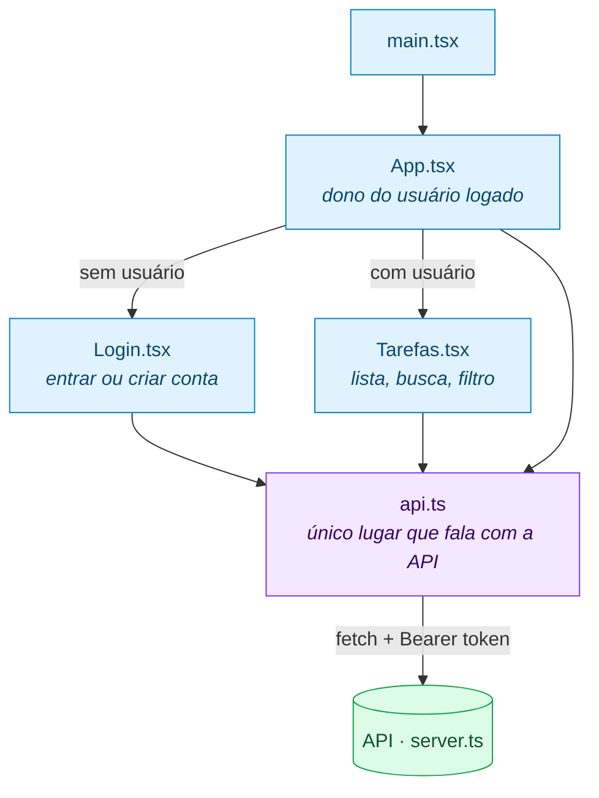

<!-- nav:topo -->
<p align="center">
  <a href="../README.md"></a>
  <a href="../docs/API.md"></a>
  
  <a href="../diario-de-bordo/README.md"></a>
  <a href="../docs/GUIA_DE_ESTUDOS.md"></a>
  <a href="../extras/README.md"></a>
</p>
<!-- /nav:topo -->

<p align="center">
  
</p>

# Front-end (React)

A tela do Gerenciador de Tarefas, feita com **React + TypeScript + Tailwind CSS** e criada com **Vite**. Ela tem a tela de login e cadastro e a lista de tarefas de quem está logado: criar, concluir, excluir, buscar por título e filtrar por prioridade. Toda conversa com o servidor passa pela [API do Gerenciador](../docs/API.md#endpoints).

**Aulas que construíram estas telas** (clique para abrir o diário):

<p>
  <a href="../diario-de-bordo/2026-10-07.md"></a>
  <a href="../diario-de-bordo/2026-10-14.md"></a>
  <a href="../diario-de-bordo/2026-10-28.md"></a>
  <a href="../diario-de-bordo/2026-11-18.md"></a>
</p>

## Arquivos

```
web/
├── index.html
├── vite.config.ts      # Vite com os plugins do React e do Tailwind
└── src/
    ├── main.tsx        # ponto de entrada
    ├── App.tsx         # decide entre a tela de login e a lista de tarefas
    ├── Login.tsx       # login e cadastro (um componente, dois modos)
    ├── Tarefas.tsx     # lista, criação, conclusão, exclusão, busca e filtro por prioridade
    ├── Icones.tsx      # ícones em SVG (livro, lupa, check)
    ├── api.ts          # único lugar que conhece o endereço da API e o token JWT
    └── index.css       # Tailwind e o tema de caderno (papel, capa, fontes)
```

## Como funciona



- **Login:** o token JWT que a API devolve fica guardado no navegador (`localStorage`) e vai junto em todo pedido, no cabeçalho `Authorization: Bearer <token>`.
- **Busca:** só vai até a API quando a pessoa para de digitar por 400 ms (debounce), para não fazer um pedido a cada letra.
- **Filtro por prioridade:** é feito na própria tela, sem chamar a API, em cima da lista que já chegou.
- **Endereço da API:** enquanto programo (`npm run dev:all`), a tela fica em `localhost:5173` e chama a API em `localhost:3000`. Depois do build, a própria API entrega a tela, e os pedidos usam o mesmo endereço do site, sem precisar de CORS.

## Como rodar

O jeito mais simples é pela raiz do projeto, que sobe a API e a tela juntas:

```bash
npm install
npm run dev:all     # tela em http://localhost:5173
```

Só a tela, a partir desta pasta (a API precisa estar ligada em outro terminal):

```bash
cd web
npm install
npm run dev         # http://localhost:5173
npm run lint        # ESLint
npm run build       # confere os tipos e gera dist/
```

Se a API não estiver ligada, a tela mostra o erro de conexão.

## Tecnologias

| Tecnologia | Uso |
| --- | --- |
| React 19 + Vite | componentes, estado e servidor de desenvolvimento |
| TypeScript | tipos da API (`Tarefa`, `Usuario`) e das telas |
| Tailwind CSS 4 | visual, com o tema de caderno definido no `index.css` |
| ESLint | regras de qualidade, incluindo as regras dos hooks do React |

<!-- nav:rodape -->
---

<p align="center">
  <a href="../docs/API.md"></a>
  <a href="#top"></a>
  <a href="../diario-de-bordo/README.md"></a>
</p>
<!-- /nav:rodape -->
